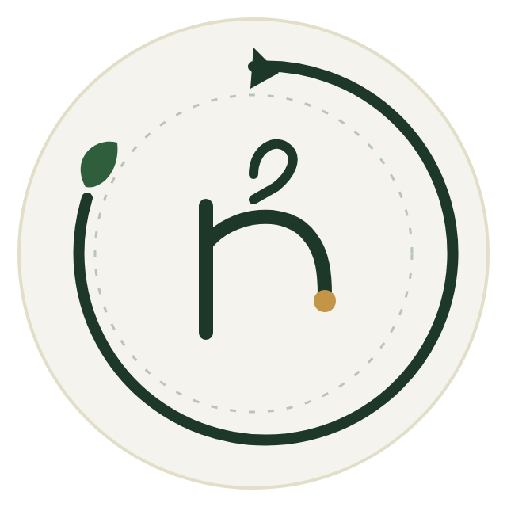

# Rewear Circle



**Mặc lại điều bạn yêu.** Rewear Circle là dự án mua bán thời trang secondhand. Người mua tìm món đồ phù hợp và đặt hàng thanh toán khi nhận hàng (COD). Người bán đăng, sửa và quản lý tin. Tin đăng được kiểm duyệt trước khi xuất hiện công khai.

## Tính năng

| Vai trò | Có thể làm gì |
| --- | --- |
| Khách | Xem, tìm kiếm và lọc sản phẩm theo danh mục, kích cỡ, tình trạng và khoảng giá. Mở chi tiết sản phẩm khi chưa đăng nhập. |
| Người mua | Đăng ký và xác minh email, quản lý giỏ hàng, đặt COD, theo dõi đơn, xác nhận đã nhận hàng và gửi khiếu nại khi đủ điều kiện. |
| Người bán | Đăng hoặc sửa tin, quản lý tủ đồ, ẩn hoặc hiện lại tin theo trạng thái, cập nhật giao hàng và ghi nhận thu COD. |
| Quản trị viên | Duyệt tin, tra cứu toàn bộ tin đăng, quản lý hiển thị, xử lý vụ việc, phân công hỗ trợ và xử lý yêu cầu hoàn COD. |
| Nhân viên hỗ trợ | Xem vụ đang mở được phân công. Mỗi lần đọc thông tin liên hệ người nhận cần có lý do. |

Trang chủ có hai nhóm sản phẩm, mỗi nhóm tối đa bốn món, và phần **Tác động xanh** với số liệu minh họa. Trang chi tiết gợi ý các món cùng danh mục.

## Công nghệ và cấu trúc

| Thành phần | Công nghệ và vị trí |
| --- | --- |
| Giao diện | Next.js App Router, React, JavaScript và CSS trong [`frontend/`](frontend/) |
| API | Node.js 24 và Express trong [`backend/`](backend/) |
| Dữ liệu | MongoDB replica set và Mongoose. MongoDB lưu dữ liệu và phiên đăng nhập, còn ảnh tải lên nằm trong volume riêng. |
| Môi trường chạy | Docker Compose, Nginx định tuyến trang và API cùng origin, Mailpit nhận email xác minh trong môi trường demo. |
| Kiểm thử | Node.js Test Runner, Playwright và GitHub Actions. |

Thư mục [`docker/`](docker/) chứa cấu hình gateway và script sao lưu, khôi phục. Thư mục [`docs/`](docs/) chứa đặc tả và hướng dẫn vận hành.

## Chạy trên máy cá nhân

Cài Git và khởi động [Docker Desktop trên Windows](https://docs.docker.com/desktop/setup/install/windows-install/) hoặc [Docker Engine với Compose trên Linux](https://docs.docker.com/compose/install/). Khi chạy toàn bộ ứng dụng qua Docker, Node.js được cài trong image.

### 1. Tạo cấu hình

Mở PowerShell ở thư mục gốc của repo:

```powershell
if (-not (Test-Path -LiteralPath '.env')) {
    Copy-Item -LiteralPath '.env.example' -Destination '.env'
}
```

Trong `.env`, đặt `SESSION_SECRET` thành chuỗi ngẫu nhiên dài và giữ `RETENTION_MODE=dry-run` cho lần chạy đầu. Có thể tạo giá trị bí mật bằng lệnh dưới đây rồi dán vào `.env`. Giữ `.env` và bản sao lưu ngoài Git.

```powershell
[guid]::NewGuid().ToString('N') + [guid]::NewGuid().ToString('N')
```

### 2. Khởi động

```powershell
docker compose -f compose.yaml -f compose.operations.yaml config --quiet
docker compose -f compose.yaml -f compose.operations.yaml up --build -d --wait gateway
docker compose -f compose.yaml -f compose.operations.yaml ps
```

- Mở [Rewear Circle](http://localhost:3001) để dùng ứng dụng. Dùng đúng hostname `localhost` để khớp cấu hình phiên đăng nhập và kiểm tra origin.
- Mở [Mailpit](http://localhost:8026) để xem mã xác minh khi đăng ký tài khoản.
- Thử [API danh sách sản phẩm](http://localhost:3001/api/v1/listings?limit=4) để kiểm tra gateway và backend.

### 3. Thêm dữ liệu mẫu nếu cần

Tài khoản có thể đăng ký và xác minh qua Mailpit. Nếu muốn tạo nhanh dữ liệu trên cơ sở dữ liệu demo, chạy lệnh seed. Dự án không tự chạy seed khi khởi động.

```powershell
docker compose -f compose.yaml -f compose.operations.yaml run --rm backend npm run seed
```

Để nhập [bộ sản phẩm mẫu](backend/src/scripts/data/demo-catalog.json), nhập email của một tài khoản người bán đã xác minh trong cùng cơ sở dữ liệu khi PowerShell hỏi. Có thể dùng `seller1@rewear.local` sau khi chạy seed.

```powershell
$sellerEmail = Read-Host "Email nguoi ban da xac minh"
docker compose -f compose.yaml -f compose.operations.yaml run --rm backend node src/scripts/importDemoCatalog.js $sellerEmail
```

### 4. Cập nhật hoặc dừng

Khi thay đổi mã, chạy lại lệnh `up --build` ở bước 2, rồi tạo lại gateway để Nginx nhận địa chỉ container mới.

```powershell
docker compose -f compose.yaml -f compose.operations.yaml up -d --no-deps --force-recreate --wait gateway
```

Khi cần dừng, dùng `stop` để giữ dữ liệu trong volume:

```powershell
docker compose -f compose.yaml -f compose.operations.yaml stop
```

## Kiểm thử và CI

Kiểm thử frontend trực tiếp trên máy cần Node.js 24. Playwright dùng Chromium và API giả lập.

```powershell
Set-Location frontend
npm ci
npm test
npm run build
npx playwright install --only-shell chromium
npm run test:e2e
```

Để kiểm thử backend, dùng cấu hình Docker cô lập trong [hướng dẫn nghiệm thu backend](docs/runbooks/backend-acceptance.md). Hai workflow [frontend](.github/workflows/frontend.yml) và [backend](.github/workflows/backend.yml) chạy khi có thay đổi liên quan trong push hoặc pull request. Chúng hiện dùng để kiểm tra mã và build.

## Triển khai công khai

Cấu hình Compose trong repo phục vụ demo cục bộ. Để triển khai lên máy chủ có tên miền, dùng cấu hình triển khai riêng và kiểm tra các điểm sau:

1. Đưa frontend và `/api/v1` lên cùng tên miền qua HTTPS. Đặt `APP_ORIGIN` bằng đúng origin công khai và cấu hình proxy để backend nhận đúng giao thức HTTPS và địa chỉ máy khách.
2. Đặt `NODE_ENV=production` cho API, tạo `SESSION_SECRET` riêng và dùng SMTP thật để gửi mã xác minh. Giữ MongoDB và các cổng nội bộ trong mạng riêng.
3. Gắn lưu trữ bền vững cho MongoDB và ảnh tải lên, rồi kiểm tra sao lưu và khôi phục. MongoDB cần replica set để thực hiện giao dịch.
4. Sau khi khởi động, kiểm tra xem danh sách, đăng ký, nhận mã xác minh, đăng nhập, tải ảnh và đặt COD qua tên miền công khai.

## Tài liệu

- [Cấu trúc và các tuyến frontend](frontend/README.md)
- [Quy ước API và mã lỗi](docs/Architecture%20%26%20Technical%20Design/API%20Contracts%20%26%20Error%20Conventions.md)
- [Vận hành, backup, khôi phục và chính sách lưu trữ](docs/runbooks/backend-fulfillment-operations.md)
